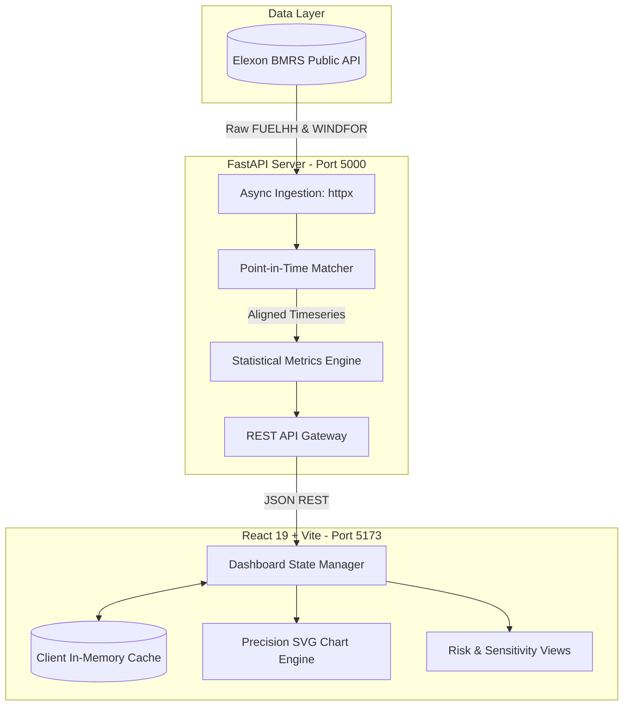

# UK Wind Forecast Terminal

A high-density quantitative analytics terminal built for a UK energy utility's Day-Ahead power procurement desk, evaluating atmospheric wind generation forecasts against live outturn from Elexon BMRS.

---

## 1. Executive Summary & Problem Context

In Great Britain's wholesale power market (EPEX SPOT / Nord Pool), electricity cannot be stored at grid scale and must be contracted prior to physical delivery. An energy utility must balance customer demand through a mix of renewable generation and gas-fired thermal plants (CCGT):

$$\text{Total Generation} = \text{Wind Generation} + \text{Thermal Generation} \approx \text{Consumer Demand}$$

### The Day-Ahead Decision Gate

- **Gate Closure**: Physical procurement decisions for Delivery Day $D$ must be submitted on Day $D-1$ before **11:00 AM UTC** (13 to 37 hours before delivery).
- **The Imbalance Risk**:
  - **Over-Forecasting ($\text{Forecast} > \text{Actual Outturn}$)**: When wind output fails to materialize, the utility falls short of contracted supply and is forced to settle volume in the Balancing Mechanism at volatile **System Buy Price (cashout)** penalties.
  - **Under-Forecasting ($\text{Forecast} < \text{Actual Outturn}$)**: When wind output exceeds forecast, the desk over-commits expensive thermal generation, burning margin on unneeded gas contracts.

### Core Objectives

1. **Decision-Time Forecast Reconstruction**: Reconstruct the exact atmospheric wind forecasts available at auction gate closure ($D-1$ at 11:00 UTC), strictly eliminating retrospective lookahead bias.
2. **Quantitative Error Evaluation**: Compute empirical forecast error metrics (MAE, Systemic Bias, RMSE, MAPE) across January 2026 to inform bid haircuts and hedging policies.

---

## 2. Point-in-Time Matching Methodology

Standard backtesting often erroneously evaluates forecasts published _after_ the auction gate closure, introducing lookahead bias. This terminal enforces a strict point-in-time selection rule:

- **Cutoff Time**: For target delivery day $D$, the gate closure cutoff is defined as:
  $$\text{Cutoff}(D) = (D - 1\text{ day}) \text{ at } \text{11:00:00 UTC}$$
- **Forecast Selection**: For each settlement period (SP1 to SP48), the engine selects the latest numerical forecast run $f$ satisfying:
  $$\text{publishTime}(f) \le \text{Cutoff}(D)$$
- Any weather model update published after 11:00 UTC on $D-1$ is discarded for Day-Ahead evaluations, accurately preserving the information state of the trader at decision time.

### Data Scope

- **Data Source**: Elexon BMRS (Balancing Mechanism Reporting Service), the official settlement data provider for Great Britain.
- **Streams Ingested**:
  - `FUELHH`: Actual half-hourly wind generation outturn (Settlement Periods SP1 to SP48).
  - `WINDFOR`: Numerical weather forecast model runs.
- **Temporal Scope**: January 2026 (744 hourly intervals / 1,488 settlement observations).

---

## 3. System Architecture



### Architectural Principles

- **Stateless Backend**: The FastAPI backend performs vector matching on-the-fly without accumulating volatile session state in server memory.
- **Sub-Microsecond Client Cache**: A client-side LRU cache (`cacheService.js`, ~0.14 µs retrieval) caches pre-computed views in browser memory for instant filter switching.
- **Pure SVG Precision Rendering**: Custom SVG charts utilize viewBox coordinate normalization (`((clientX - rect.left) / rect.width) * width`), eliminating cursor drift across high-DPI displays.

---

## 4. Quantitative Metrics & Findings (January 2026)

### Mathematical Formulation

Let $A_i$ be actual wind outturn (MW) and $F_i$ be the gate-closure forecast (MW) for interval $i \in \{1, \dots, N\}$:

| Metric                                    | Formula                                                           | Trading Desk Significance                                                                            |
| :---------------------------------------- | :---------------------------------------------------------------- | :--------------------------------------------------------------------------------------------------- |
| **Forecast Error ($e_i$)**                | $e_i = F_i - A_i$                                                 | Positive = physical shortfall (cashout penalty risk); Negative = surplus (thermal over-procurement). |
| **Mean Absolute Error (MAE)**             | $\frac{1}{N} \sum_{i=1}^N \|F_i - A_i\|$                          | Average hourly volume exposed to cashout imbalances. Directly sizes reserve capital.                 |
| **Mean Bias Error (MBE)**                 | $\frac{1}{N} \sum_{i=1}^N (F_i - A_i)$                            | Directional asymmetry. Positive MBE signifies chronic model over-prediction.                         |
| **Root Mean Square Error (RMSE)**         | $\sqrt{\frac{1}{N} \sum_{i=1}^N (F_i - A_i)^2}$                   | Heavily penalizes extreme blunders (e.g., sudden cyclonic ramp mismatches).                          |
| **Mean Absolute Percentage Error (MAPE)** | $\frac{1}{N} \sum_{i=1}^N \frac{\|F_i - A_i\|}{A_i} \times 100\%$ | Relative performance normalized against generation volume.                                           |

### January 2026 Analytical Results

| Metric                         | Result                    | Operational Takeaway                                                                                                                                    |
| :----------------------------- | :------------------------ | :------------------------------------------------------------------------------------------------------------------------------------------------------ |
| **Mean Absolute Error (MAE)**  | **2,123 MW** (22.1% MAPE) | Average hourly volume requiring spot-market balancing.                                                                                                  |
| **Systemic Bias (MBE)**        | **+1,840 MW**             | **84.4% of hours were over-forecasted**. Weather models chronically overestimated wind output. Desk should apply a 15–20% downward haircut to raw bids. |
| **Severe Shortfall Risk**      | **58.2% of hours**        | Imbalance exceeded $+1,500\text{ MW}$, requiring fast-response gas peaker backup.                                                                       |
| **Average Wind Generation**    | **9,615 MW**              | Base output across Great Britain during the evaluation window.                                                                                          |
| **16:00 Intraday Cutoff Gain** | **-7.5% (-161 MW MAE)**   | Updating positions with afternoon model runs significantly cuts error, justifying an active intraday rebalancing book.                                  |

### Market Gate Sensitivity Analysis

| Cutoff Time   | Market Milestone                |  MAE (MW)   |  RMSE (MW)  | Systemic Bias (MBE) | Variance vs 07:30 |
| :------------ | :------------------------------ | :---------: | :---------: | :-----------------: | :---------------: |
| **07:30 UTC** | Early Desk Preparation          |   2,142.1   |   2,631.5   |      +1,862.3       |     Baseline      |
| **09:30 UTC** | Pre-Auction Finalization        |   2,130.4   |   2,624.1   |      +1,848.7       |       -0.5%       |
| **11:00 UTC** | **EPEX SPOT Day-Ahead Auction** | **2,122.8** | **2,616.7** |    **+1,840.3**     |     **-0.9%**     |
| **12:00 UTC** | Nord Pool GB Auction            |   2,118.0   |   2,611.2   |      +1,835.4       |       -1.1%       |
| **16:00 UTC** | Afternoon Intraday Gate         |   1,980.9   |   2,478.6   |      +1,691.0       |     **-7.5%**     |
| **18:00 UTC** | Evening Intraday Optimization   |   1,935.2   |   2,426.8   |      +1,643.5       |     **-9.7%**     |

---

## 5. API Reference

The backend exposes RESTful endpoints under `/api/energy` with interactive OpenAPI documentation available at `/docs`:

| Method | Endpoint                        | Query Parameters                                                   | Description                                                                          |
| :----- | :------------------------------ | :----------------------------------------------------------------- | :----------------------------------------------------------------------------------- |
| `GET`  | `/api/energy/day-ahead`         | `startDate`, `endDate`, `cutoffHour`, `cutoffMinute`, `resolution` | Timeseries of matched forecast vs actual outturn, error deltas, and summary metrics. |
| `GET`  | `/api/energy/metrics`           | `startDate`, `endDate`, `cutoffHour`, `cutoffMinute`, `resolution` | Summary accuracy statistics (MAE, RMSE, MAPE, MBE, Over/Under distribution).         |
| `GET`  | `/api/energy/daily-metrics`     | `startDate`, `endDate`, `cutoffHour`, `cutoffMinute`               | Day-by-day aggregated performance breakdown across the specified date range.         |
| `GET`  | `/api/energy/hourly-profile`    | `startDate`, `endDate`, `cutoffHour`, `cutoffMinute`               | Diurnal 24-hour error profile aggregated across hours 00:00–23:00 UTC.               |
| `GET`  | `/api/energy/cutoff-comparison` | `startDate`, `endDate`                                             | Comparative accuracy matrix across the 5 standard market milestones.                 |
| `GET`  | `/health`                       | —                                                                  | Service health status check.                                                         |

---

## 6. Repository Structure

```
energy/
├── docker-compose.yml          # Container orchestration (Frontend + Backend)
├── server/                     # Backend API Service (Python / FastAPI)
│   ├── Dockerfile              # Production Python container spec
│   ├── requirements.txt        # Backend dependencies
│   ├── .env.example            # Backend environment template
│   ├── main.py                 # FastAPI application initialization & routing
│   ├── app/
│   │   ├── config.py           # Default constants & environment parsing
│   │   ├── elexon_client.py    # Async HTTP client for Elexon BMRS streams
│   │   ├── matcher.py          # Point-in-time matching engine (D-1 cutoff logic)
│   │   ├── metrics.py          # Statistical metrics calculation engine
│   │   └── routes/
│   │       └── energy.py       # REST API endpoint definitions
│   └── tests/                  # Automated pytest suite (14 tests)
│       ├── test_api_endpoints.py
│       ├── test_matcher.py
│       ├── test_metrics.py
│       └── benchmark_latency.py
└── client/                     # Frontend Terminal Interface (React 19 / Vite)
    ├── Dockerfile              # Static container build spec
    ├── package.json            # Node.js dependencies and scripts
    ├── vite.config.js          # Vite build configuration
    ├── index.html              # Single-page application entry point
    ├── .env.example            # Client environment template
    ├── src/
    │   ├── App.jsx             # Root layout and view composition
    │   ├── main.jsx            # React root mount
    │   ├── components/         # Modular terminal components
    │   │   ├── charts/         # SVG time-series and delta charts
    │   │   ├── controls/       # Date pickers, resolution toggles, cutoff selector
    │   │   ├── kpi/            # Metric summary strip
    │   │   ├── table/          # Audit record table & sensitivity matrix
    │   │   └── tabs/           # Analytics view tabs (Risk, Sensitivity, Diurnal)
    │   ├── hooks/              # Custom React hooks (useDashboardData)
    │   └── services/           # API integration & client-side LRU cache
    └── tests/                  # Client-side cache verification
        └── test_cache_service.js
```

---

## 7. Installation & Quick Start

### Prerequisites

- **Python**: 3.11+
- **Node.js**: 20+
- **Docker & Docker Compose** (Optional, for containerized run)

---

### Option A: Local Development Setup

#### 1. Backend Server Setup

```bash
cd server

# Create and activate virtual environment
python -m venv venv
# On Windows:
.\venv\Scripts\activate
# On Linux/macOS:
source venv/bin/activate

# Install dependencies
pip install -r requirements.txt

# (Optional) Copy environment template
cp .env.example .env

# Start backend service
python -m uvicorn main:app --host 127.0.0.1 --port 5000
```

- **API Root**: [http://127.0.0.1:5000](http://127.0.0.1:5000)
- **Interactive OpenAPI Docs**: [http://127.0.0.1:5000/docs](http://127.0.0.1:5000/docs)

#### 2. Frontend Terminal Setup

```bash
cd client

# Install dependencies
npm install

# (Optional) Copy environment template
cp .env.example .env

# Start development server
npm run dev
```

- **Terminal Interface**: [http://localhost:5173](http://localhost:5173)

---

### Option B: Docker Compose Setup

Run the entire application stack with a single command (ports default to 5000 and 5173):

```bash
# 1. Build and run containers in detached mode
docker compose up --build -d

# 2. Check service health
docker compose ps

# 3. View logs
docker compose logs -f

# 4. Teardown
docker compose down
```

- **Client Web App**: [http://localhost:5173](http://localhost:5173)
- **Backend API Docs**: [http://localhost:5000/docs](http://localhost:5000/docs)

---

## 8. Verification & Test Suite

The project includes unit and integration tests across both backend and frontend layers:

```bash
# 1. Run Backend Pytest Suite (14 unit & integration tests)
cd server
python -m pytest tests/ -v

# 2. Run Frontend In-Memory Cache Verification (5 tests)
cd client
node tests/test_cache_service.js
```

### Test Coverage Highlights

- **Point-in-Time Integrity**: Tests verify that forecasts published at 11:00:01 UTC or later on $D-1$ are excluded from Day $D$ matching.
- **Metric Correctness**: Validates MAE, RMSE, MBE, and zero-actual divide-by-zero protection.
- **Cache Determinism**: Validates query key generation order-independence and LRU eviction speed.

---

## 9. Assumptions & System Boundaries

- **Asset Scope**: Focused strictly on aggregated national wind generation across Great Britain; excludes solar PV, battery storage, and distributed embedded wind.
- **Network Constraints**: Grid-level aggregate modeling; transmission boundary congestion (e.g., Scotland-to-England B6 boundary constraints) is not modeled.
- **Temporal Scope**: Tested on the January 2026 operational window (744 hours).

---

## 10. AI Assistance & Development Tools

In accordance with academic and technical disclosure standards:

- **AI Model**: **Gemini** was utilized for pair-programming assistance, algorithmic formulation of the point-in-time matching logic, and test suite generation.
- **Development Environment**: **Google Antigravity IDE** was used as the primary agentic coding and development workspace for project scaffolding, execution, and verification.

---

## 11. Submission Details

- **Author / Submitter**: Jitendra Prajapati
- **Project Status**: Complete & Validated for Submission.
